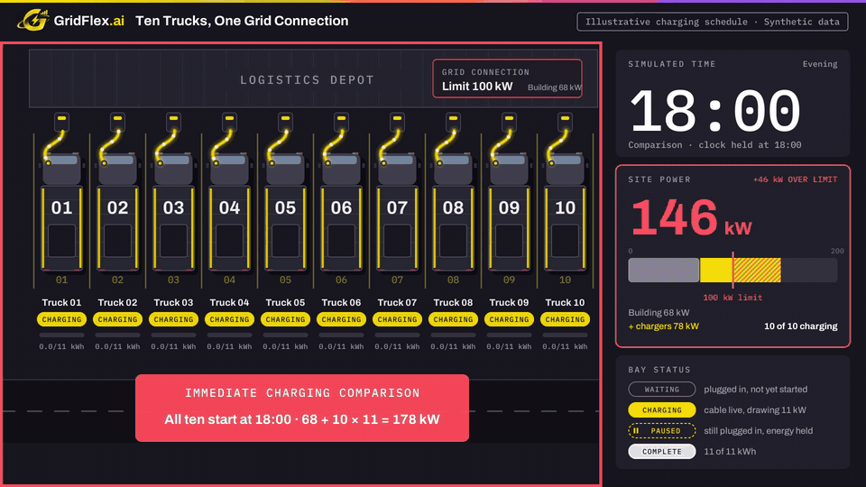
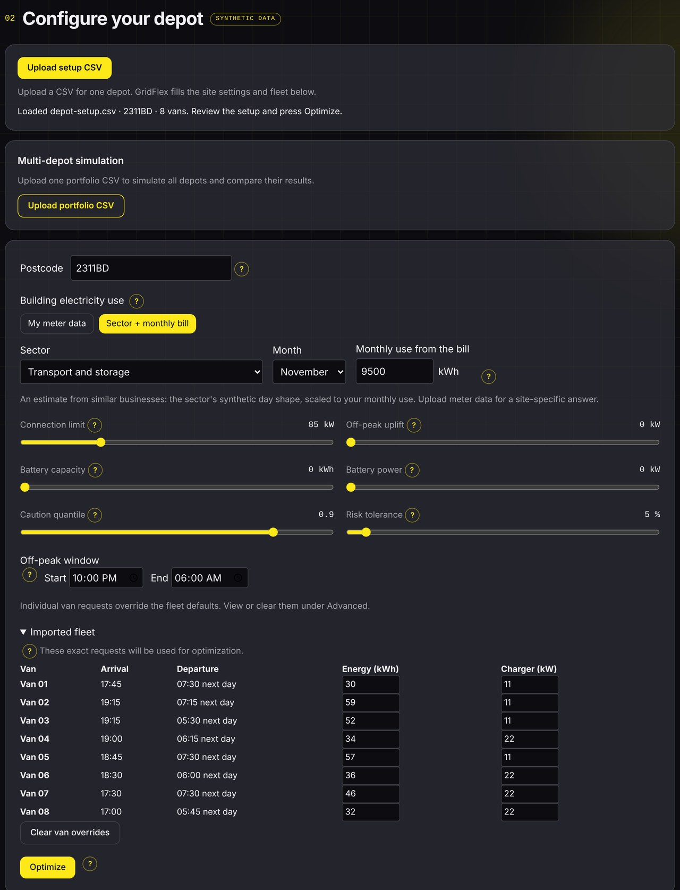
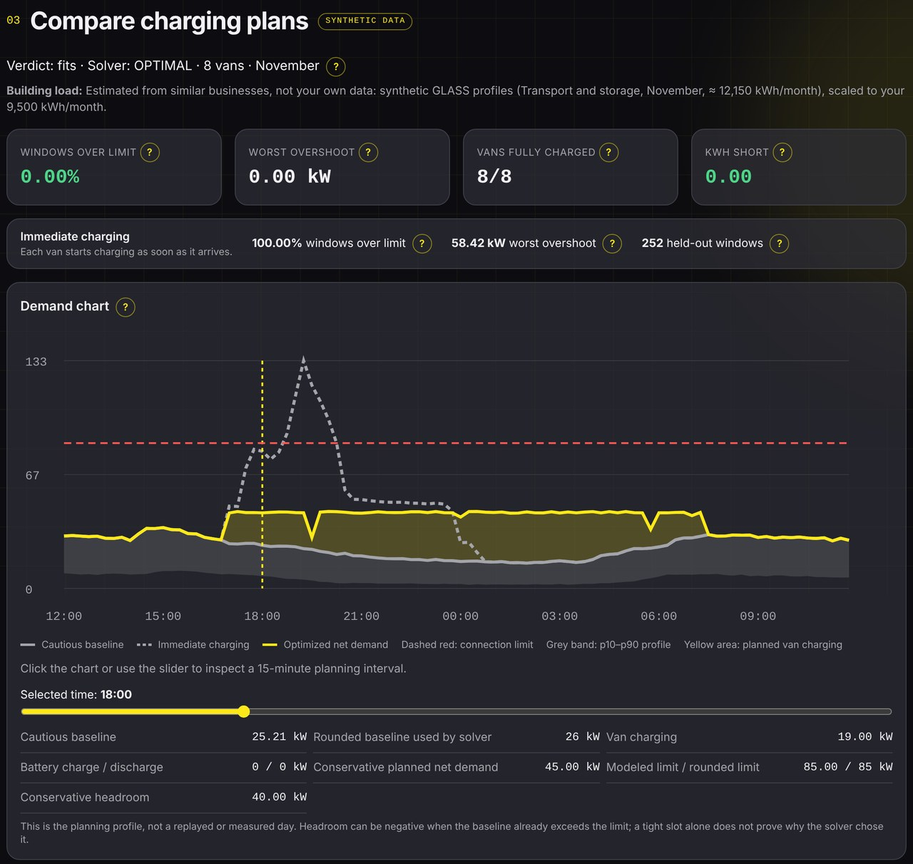
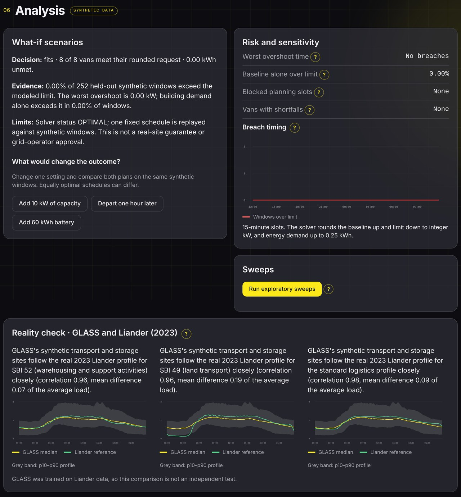
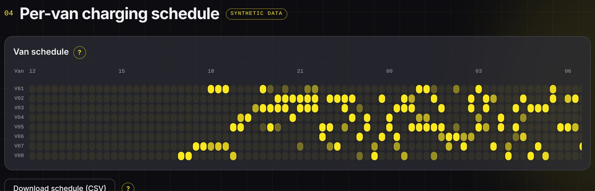
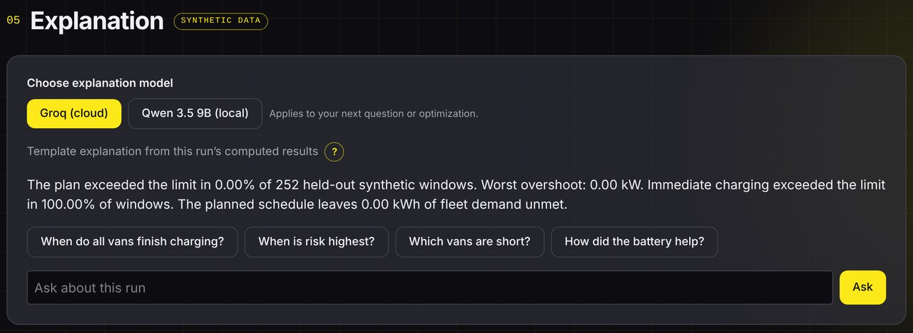
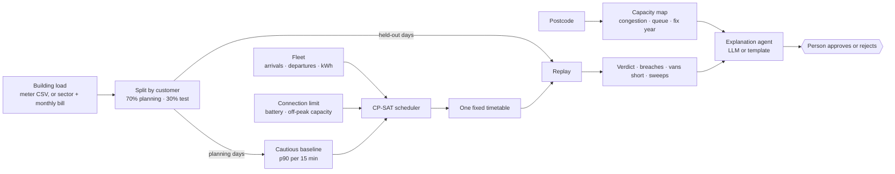

<p align="center">
  
</p>

<p align="center">
  
  
  
  
  
</p>

# GridFlex AI: Plan. Stress-test. Explain.

**Can my business add EV chargers without a bigger grid connection?**

GridFlex takes a business's postcode, sector, month and fleet, and:

1. **Shows the local grid situation:** is the area congested, how long is the queue, and when is it expected to be fixed?
2. **Plans** a charging timetable for every van (plus an optional on-site battery) that stays under the site's connection limit.
3. **Stress-tests** that plan on realistic days it has never seen: how often, when and by how much the site would still go over the limit, and which vans end up short of charge.
4. **Explains** the result in plain language. A person approves or rejects it; nothing is switched automatically.

The building's own electricity use comes from the site's own **meter data** (CSV upload), or, without history, from a **sector + month + monthly bill** (an estimate from similar businesses). Everything else is simulation: the app only recommends, and is not a grid-operator approval.

> *"We don't test your plan on one made-up day. We test it on every realistic day."*

EY AI Week Hackathon, 5–6 November 2026, Amsterdam. Original concept: GridFlex AI by Smriti Sridhar (Leiden University).

## See it in action

<p align="center">
  
</p>
<p align="center"><sub><b>Ten trucks, one grid connection.</b> Charging on arrival would draw 178 kW on a 100 kW connection. Staggered two at a time, the site stays at 90 kW and every truck is full by 23:00. Illustrative charging schedule · synthetic data.</sub></p>

## The dashboard

<table>
  <tr>
    <td width="50%" valign="top"><br><sub><b>Welcome.</b> One place to plan a depot, from setup to decision.</sub></td>
    <td width="50%" valign="top"><br><sub><b>Setup.</b> Postcode, building use from meter data or the energy bill, connection limit, battery, off-peak capacity and the fleet. Single depots and portfolios can be loaded from CSV.</sub></td>
  </tr>
  <tr>
    <td valign="top"><br><sub><b>Charging plan.</b> Verdict, held-out risk and the demand chart: immediate charging (dotted) against the optimised plan (yellow) and the connection limit (red).</sub></td>
    <td valign="top"><br><sub><b>Analysis.</b> What-if buttons, risk and sensitivity, breach timing, sweeps and the reality check against Liander’s measured 2023 profiles.</sub></td>
  </tr>
  <tr>
    <td valign="top"><br><sub><b>Van schedule.</b> Every van’s charging slots in 15-minute steps, with kWh delivered and short. Exportable as CSV.</sub><br><br>
    <br><sub><b>Explanation.</b> Groq or a local Qwen model, grounded in computed facts, with a deterministic template as the fallback. Ask follow-up questions about the run.</sub></td>
    <td valign="top"><br><sub><b>Portfolio.</b> Upload many depots at once, compare their verdicts and download a PDF report. Shown: <code>examples/case_5</code>, five depots with one of each verdict.</sub></td>
  </tr>
</table>

<sub>Screenshots from a local run on the example files in <a href="examples/">examples/</a>. All load profiles are synthetic (GLASS) unless a site uploads its own meter data; results are simulations, not grid-operator approvals.</sub>

## How it works



| Step | What happens |
|---|---|
| **Locate** | The postcode card shows the local congestion colour, waiting list, expected fix year and planned grid projects from the operators’ capacity map. |
| **Plan** | A constraint-programming model (Google OR-Tools CP-SAT) gives every van a charging timetable, with an optional battery, that never plans above the limit on a cautious day. |
| **Stress-test** | The same fixed timetable is replayed on days it was never planned on: how often the site goes over, when, by how much, and which vans end up short. |
| **Explain** | An explanation agent describes only numbers the code computed. A person approves or rejects; nothing is switched automatically. |

---

The full idea, architecture and module interfaces are in [idea.md](idea.md). Rules for contributors (including AI agents) are in [AGENTS.md](AGENTS.md).

---

## Quick start

You need about **15 GB of free disk space** (the raw downloads are 13.6 GB, of which GLASS is 13.2 GB; the app itself reads only the 211 MB made from them) and an internet connection.

### 1. Install the tools

**Windows** (PowerShell):

```powershell
winget install --id Git.Git -e
winget install --id Python.Python.3.11 -e
winget install --id OpenJS.NodeJS.LTS -e
```

Open a new terminal afterwards so the tools are on your `PATH`. On macOS or Linux, install Git, Python 3.11 and Node.js (LTS) with your package manager.

### 2. Get the code and the Python packages

```bash
git clone git@github.com:josh1221wa/ey_hackathon.git
cd ey_hackathon
python -m venv .venv
```

Activate the environment (every new terminal needs this):

```powershell
.venv\Scripts\activate
```

On macOS or Linux: `source .venv/bin/activate`. Then:

```bash
pip install -r requirements.txt
```

### 3. Get the data (once)

No data is stored in git. You download the raw datasets with one script and make the small files the app reads (`data/processed/`) with another.

```bash
python scripts/download_data.py
```

This downloads three datasets into `data/raw/`: the GLASS file (13.2 GB), the grid capacity map and Liander's profiles (see [where the data comes from](#where-the-data-comes-from)), and checks GLASS against its SHA-256 (a few minutes after the download). It takes roughly 5 to 30 minutes, depending on your connection. **If the connection drops, run the same command again: it resumes** where it stopped and skips what is already complete. Then process everything (about half a minute):

```bash
python scripts/setup_data.py build
```

Check that everything is in place:

```bash
python scripts/setup_data.py status
```

It should list GLASS 480 of 480, grid map 4 of 4 and Liander 37 of 37, and say `Complete.` Afterwards you can delete `data/raw/GLASS_v1.1.parquet` if you need the space; you only need it again to rebuild.

**Shortcut:** if a teammate who has the finished `data/processed/` folder runs `python scripts/setup_data.py pack`, they get `data/processed_data.zip` (about 215 MB). Skip the download and run `python scripts/setup_data.py unpack path/to/processed_data.zip`.

### 4. Run it

Two terminals. In the first (with the virtual environment active, from the repo folder):

```bash
uvicorn api.main:app --reload
```

Wait for "Application startup complete" (about 20 seconds). In the second:

```bash
cd ui
npm ci
npm run dev
```

Open the address Vite prints. Go to **Setup**, pick your sector, month and monthly bill (or upload meter data; there is an example file on the page), and press **Optimize**.

### 5. Optional: explanations from an LLM

The explanation tab works without any key, using deterministic templates. For answers written by a model, create a file named `.env` in the repo root (it is git-ignored; never commit it):

```
GROQ_API_KEY=your-key-here
```

Restart the API afterwards. A local model through Ollama (`qwen3.5:9b`) also works; see [ui/README.md](ui/README.md).

### 6. Try the example files

The [examples/](examples/) folder has seven ready-made scenarios, one folder each (`case_1` to `case_7`): a depot that uses its energy bill, three depots with their **own meter data**, a 5-depot portfolio, a 30-depot portfolio and a 649-depot stress test. Upload the files of one case together. [examples/README.md](examples/README.md) describes every case, says what to upload and in which order, what you should see, and what every column means, including where the monthly bill (`monthly_kwh`) goes.

### 7. Run the tests

```bash
pytest
```

```bash
cd ui && npm test
```

Without the processed data, the tests that need it skip themselves (they say why) and the rest still run.

---

## Where the data comes from

| Dataset | What it is | Where it comes from | Needed for |
|---|---|---|---|
| **GLASS v1.1** | Synthetic daily load profiles of Dutch large business customers (60–160 kW connections), 15-minute readings, 3 years. License CDLA-Permissive-2.0. | [4TU.ResearchData, doi:10.4121/b18de4df-0f67-4a6f-aa84-6634cdd63991](https://doi.org/10.4121/b18de4df-0f67-4a6f-aa84-6634cdd63991) (`GLASS_v1.1.parquet`, 13.2 GB). Dataset card: [data/README.md](data/README.md). | The building's electricity use. |
| **Capacity map** | Which postcodes have grid congestion, the queue per supply area and expected fix year. A snapshot, indicative only. | [Netbeheer Nederland capaciteitskaart](https://capaciteitskaart.netbeheernederland.nl) | The postcode card. |
| **Liander profiles** | Real measured 2023 consumption profiles per sector (SBI code) from Liander's large customers. | [Liander open data](https://www.liander.nl/over-ons/open-data) ("Verbruiksprofielen grootverbruikaansluitingen elektriciteit 2023") | The reality check next to the synthetic data. |

Do not use the Hugging Face copy of GLASS (`sentient-codebot/tud-glass`): it is v1.0, a different file.

`python scripts/download_data.py` downloads all three (about 13.6 GB). You can also fetch one: `python scripts/download_data.py glass`, `capacity` or `liander`.

The capacity map is a **live snapshot** that its owners update regularly, so a fresh download can differ from the one this project was built on (5 November 2026): the postcode card shows the download date, and some numbers in the docs may not match exactly. GLASS and Liander's 2023 profiles do not change. To refresh only the capacity map later, delete `data/raw/capaciteitskaart/`, run `python scripts/download_data.py capacity`, then `python scripts/setup_data.py build`.

**What the 480 files are:** GLASS 2024 (the latest year in the dataset), all 12 months, 4 consumption levels, 40 samples per condition, for the fleet-depot sectors (transport and storage, wholesale and retail, water and waste, construction, administrative and support, manufacturing) plus four operating-hours classes as a generic fallback. The reasoning is in [idea.md](idea.md) section 4.5. To change the set, edit `CATEGORIES`, `MONTHS` and `SAMPLES` in `scripts/setup_data.py`.

---

## Repository layout

```
idea.md          the idea and implementation plan (source of truth)
AGENTS.md        rules for everyone working here
HANDOFF.md       what exists and how to call it, between teammates
TODO.md          tasks per person
data/README.md   the GLASS dataset card (the only file under data/ that is in git)
data/raw/        downloads (git-ignored, never commit)
data/processed/  small files the app reads, made from data/raw by setup_data.py (git-ignored)
examples/        seven ready-made scenarios to try the app with (case_1 to case_7)
scripts/         download_data, setup_data, extract_glass, prepare_grid_map, prepare_liander_sbi
gridflex/        library code: profiles, scheduler, replay, reality, explanations
api/             the Python JSON API (FastAPI)
ui/              the React + TypeScript dashboard
tests/           pytest tests
```

---

## Troubleshooting

- **The dashboard has no sectors, the postcode card is empty, or the API says a `glass_...parquet` file was not found:** the data is not set up. Run `python scripts/setup_data.py status` and follow what it prints.
- **`python` is not found or opens the Microsoft Store:** install Python with the `winget` command above and open a new terminal. Use the Python from the activated `.venv`.
- **`could not reach the GridFlex API` in the browser:** start the API first (step 4) and wait for "Application startup complete".
- **The download stops or fails:** run the same command again. Finished files are skipped and partial ones resume. If it reports the link moved, the source pages are listed in the table above.
- **"SHA-256 mismatch":** the GLASS file is damaged or a different version. Delete `data/raw/GLASS_v1.1.parquet` and run the download again.
- **"Not enough disk space":** the download needs about 14 GB free where `data/raw/` lives.

---

## Contributing

Nobody pushes to `main`, including AI agents. Make a branch named `<name>-<change>` (for example `smriti-dashboard-shell`), commit there, push it and open a pull request with a title and a description of what changed, why and how it was tested. The full rules are in [AGENTS.md](AGENTS.md).

## Honesty

Everything in the app is labelled as **synthetic data and simulation**, and the fleet values are assumptions. Only results built on a site's own meter data drop "synthetic", and they are still a simulation. The app shows kWh short and days over the limit even when they are bad. The explanation agent only describes numbers the code has already computed.

## Attribution

GLASS (CDLA-Permissive-2.0, TU Delft, OpenSynth / LF Energy) · Netbeheer Nederland, capaciteitskaart (with the download date shown in the app) · Liander (2023), open data. More in [idea.md](idea.md) section 14.
