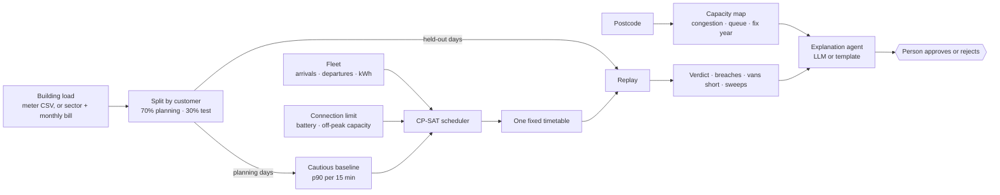

<p align="center">
  
</p>

<p align="center">
  
  
  
  
  
</p>

<p align="center">
  <a href="index.html">Website source</a> ·
  <a href="#watch">Watch</a> ·
  <a href="#why">Why</a> ·
  <a href="#how-it-works">How it works</a> ·
  <a href="#quick-start">Quick start</a> ·
  <a href="#interpreting-results">Interpreting results</a> ·
  <a href="#documentation">Docs</a> ·
  <a href="#team">Team</a>
</p>

---

# GridFlex

**GridFlex** helps depot operators decide whether electric vans can get the energy they need before departure using the site's existing electricity connection. It looks up local congestion, proposes a charging timetable and tests that same timetable against building demand the planner never saw.

Start with one depot or upload a portfolio CSV to compare many sites. Use a site's own meter readings when available, or estimate building demand from its sector, month and electricity bill.

The repository includes synthetic examples. GridFlex is a planning prototype. A person reviews the recommendation, and the grid operator confirms available capacity.

## Watch

[Watch the GridFlex pitch video](media/gridflex-pitch.mp4).

<p align="center">
  
</p>
<p align="center"><sub><b>Ten trucks, one grid connection.</b> Charging on arrival would draw 178 kW on a 100 kW connection. Staggered two at a time, the site stays at 90 kW and every truck is full by 23:00. Illustrative charging schedule · synthetic data.</sub></p>

## Why

- **Getting more grid capacity can take time.** A postcode lookup shows the local queue and any expected relief. The site's own connection limit is a separate planning input.
- **Charging on arrival can create a peak.** Ten vans drawing 11 kW each need 110 kW before the building uses any power. A timetable can spread charging across the hours the vans are parked.
- **Building demand changes.** A timetable that works on the planning profile can still exceed the limit on a busier day. Replaying the same schedule shows when that happens and how large the breach is.

## How it works



| Stage | What it does | Code |
| --- | --- | --- |
| **Locate** | Looks up local congestion, the queue and expected relief from a dated postcode snapshot. | [Grid area lookup](gridflex/grid_area.py) |
| **Prepare** | Builds a load profile from meter readings or GLASS, then separates planning data from held-out data by date for meter readings or by customer for GLASS. | [Load sources](gridflex/load_sources.py) · [Profiles](gridflex/profiles.py) |
| **Plan** | Uses OR-Tools CP-SAT to schedule vans and an optional battery in 15-minute slots. The solver prioritises reducing unavoidable overload, unmet energy, peak demand and battery cycling, in that order. | [Scheduler](gridflex/scheduler.py) |
| **Stress-test** | Replays the fixed timetable on held-out demand. Compares it with charging on arrival and measures breaches and charging shortfalls. | [Replay](gridflex/replay.py) |
| **Review** | Shows the timetable, risk and what-if results. For portfolios, compares depots and exports a PDF. Groq or local Qwen can explain computed evidence. | [Dashboard](ui/) · [API](api/) |

### Dashboard

<table>
  <tr>
    <td width="50%" valign="top"><br><sub><b>Setup.</b> Postcode, building use from meter data or the energy bill, connection limit, battery, off-peak capacity and the fleet. Single depots and portfolios can be loaded from CSV.</sub></td>
    <td width="50%" valign="top"><br><sub><b>Charging plan.</b> Verdict, held-out risk and the demand chart: immediate charging (dotted) against the optimised plan (yellow) and the connection limit (red).</sub></td>
  </tr>
  <tr>
    <td colspan="2" valign="top"><br><sub><b>Portfolio.</b> Upload many depots at once, compare their verdicts and download a PDF report. Shown: <code>examples/case_5</code>, five depots with one of each verdict.</sub></td>
  </tr>
</table>

<sub>Screenshots from a local run on the example files in <a href="examples/">examples/</a>. All load profiles are synthetic (GLASS) unless a site uploads its own meter data; results are simulations, not grid-operator approvals.</sub>

## Quick start

### Requirements

- Python 3.11 and Node.js LTS
- Git and an internet connection
- Prepared data: approximately 215 MB for the ZIP, or about 15 GB free to download and build from raw data

### 1. Clone and install

```bash
git clone https://github.com/Coke-and-Code-Dev/GridFlex.git
cd GridFlex
python3 -m venv .venv
source .venv/bin/activate
python -m pip install -r requirements.txt
```

On Windows PowerShell, activate the environment with `.venv\Scripts\Activate.ps1` instead.

### 2. Prepare the data

Processed data is not committed to Git. If you have a verified ZIP created with `setup_data.py pack`, run:

```bash
python scripts/setup_data.py unpack path/to/processed_data.zip
python scripts/setup_data.py status
```

Alternatively, download and build the data yourself:

```bash
python scripts/download_data.py
python scripts/setup_data.py build
python scripts/setup_data.py status
```

The raw downloads total approximately 13.6 GB. The status command reports whether the GLASS, grid-map and Liander extracts are present. For sources and licensing, see [data/README.md](data/README.md).

### 3. Start the API and dashboard

In the activated environment, from the repository root:

```bash
python -m uvicorn api.main:app --reload --port 8000
```

In a second terminal:

```bash
cd ui
npm ci
npm run dev
```

Open the URL printed by Vite. The dashboard defaults to an API at `http://127.0.0.1:8000`; set `VITE_GRIDFLEX_API_URL` when the API runs elsewhere. See [ui/README.md](ui/README.md) for frontend and local-model details.

### 4. Try an example

The [examples](examples/README.md) include individual depots, meter-data uploads, a five-depot portfolio, a 30-depot portfolio and a 649-depot stress test. The examples are demonstrations, not operational recommendations.

### Optional: model-generated explanations

For Groq, add `GROQ_API_KEY` to a Git-ignored `.env` file in the repository root and restart the API. Never commit credentials. You can also use a locally running Ollama model; the portfolio assistant defaults to `qwen3:4b-instruct`, while the single-depot explanation defaults to `qwen3.5:9b`. See [ui/README.md](ui/README.md) for the model override.

When Groq is selected, questions and relevant computed context are sent to the provider. Meter uploads are held in API memory until restart; portfolio results are stored locally in `.gridflex-local/` until deleted. This prototype has no user authentication or automatic retention policy.

### 5. Run the tests


```bash
python -m pytest
```

```bash
cd ui
npm test
```

Tests that need processed data skip when the relevant files are unavailable.

## Interpreting results

| Result | What it means |
| --- | --- |
| **Fits** | All vans receive their requested energy and the share of test windows over the limit is within the chosen tolerance. |
| **Fits with risk** | All vans receive their requested energy, but the share of test windows over the limit exceeds the tolerance. |
| **Does not fit** | At least one van is short of charge in the planned timetable. |
| **Breach rate** | The share of held-out windows with at least one quarter hour over the limit. |
| **Worst overshoot** | The largest amount, in kW, by which demand exceeded the limit in any test slot. |
| **Solver status** | `OPTIMAL` means the solver proved the best result under its rules. Even an optimal plan can leave vans short. |
| **Reality check** | For supported sectors, compares the daily shape of GLASS demand with a Liander reference. |

## Documentation

| Guide | Covers |
| --- | --- |
| [Dataset card](data/README.md) | GLASS documentation and licensing |
| [Dashboard guide](ui/README.md) | Running the UI, configuring explanations and uploading CSVs |
| [Example cases](examples/README.md) | Files to upload, expected results and CSV column definitions |
| [Pitch video](video/README.md) | Remotion source and rendering instructions |

### Data sources

| Dataset | What it is | Where it comes from | Needed for |
|---|---|---|---|
| **GLASS v1.1** | Synthetic daily load profiles of Dutch large business customers (60–160 kW connections), 15-minute readings, 3 years. License CDLA-Permissive-2.0. | [4TU.ResearchData, doi:10.4121/b18de4df-0f67-4a6f-aa84-6634cdd63991](https://doi.org/10.4121/b18de4df-0f67-4a6f-aa84-6634cdd63991) (`GLASS_v1.1.parquet`, 13.2 GB). Dataset card: [data/README.md](data/README.md). | The building's electricity use. |
| **Capacity map** | Which postcodes have grid congestion, the queue per supply area and expected fix year. A snapshot, indicative only. | [Netbeheer Nederland capaciteitskaart](https://capaciteitskaart.netbeheernederland.nl) | The postcode card. |
| **Liander profiles** | Real measured 2023 consumption profiles per sector (SBI code) from Liander's large customers. | [Liander open data](https://www.liander.nl/over-ons/open-data) ("Verbruiksprofielen grootverbruikaansluitingen elektriciteit 2023") | The reality check next to the synthetic data. |

Do not use the Hugging Face copy of GLASS (`sentient-codebot/tud-glass`): it is v1.0, a different file.

`python scripts/download_data.py` downloads all three (about 13.6 GB). You can also fetch one: `python scripts/download_data.py glass`, `capacity` or `liander`.

The capacity map is a **live snapshot** that its owners update regularly, so a fresh download can differ from the one this project was built on (5 November 2026): the postcode card shows the download date, and some numbers in the docs may not match exactly. GLASS and Liander's 2023 profiles do not change. To refresh only the capacity map later, delete `data/raw/capaciteitskaart/`, run `python scripts/download_data.py capacity`, then `python scripts/setup_data.py build`.

### Troubleshooting

- **The dashboard has no sectors, the postcode card is empty, or the API says a `glass_...parquet` file was not found:** the data is not set up. Run `python scripts/setup_data.py status` and follow what it prints.
- **`python` is not found or opens the Microsoft Store:** install Python 3.11 and open a new terminal. Use the Python from the activated `.venv`.
- **`could not reach the GridFlex API` in the browser:** start the API first (step 3) and wait for "Application startup complete".
- **The download stops or fails:** run the same command again. Finished files are skipped and partial ones resume. If it reports the link moved, see [Data sources](#data-sources).
- **"SHA-256 mismatch":** the GLASS file is damaged or a different version. Delete `data/raw/GLASS_v1.1.parquet` and run the download again.
- **"Not enough disk space":** the download needs about 14 GB free where `data/raw/` lives.
## Repository layout

```text
api/        FastAPI endpoints, CSV imports and portfolio results
gridflex/   Load profiles, scheduling, replay and explanations
ui/         React and TypeScript dashboard
scripts/    Data download, preparation and packaging
examples/   Example depots, portfolios and meter files
tests/      Python tests
docs/       README graphics
data/       Dataset documentation and local data
video/      Remotion pitch-video source
media/      Rendered pitch video
index.html  Standalone project website
```

## Status and limitations

- Results describe a simulated schedule on the selected test windows. Confirm the site's capacity with its grid operator before acting.
- The capacity map is a dated snapshot. The Liander comparison checks demand shape, and GLASS was trained on Liander data.
- Battery replay reuses the planned battery actions and clips negative grid draw without recalculating battery state for every window.
- AI answers use computed evidence. Check the supporting facts when an interpretation matters.

## Contributing

Create a descriptive branch and open a pull request to `main` with the problem, changes and validation. Avoid committing credentials, uploaded customer data, raw datasets or generated build output.

## Team

Built for the **EY AI Week Hackathon** in Amsterdam, 5–6 November 2026.

[Smriti Sridhar](https://github.com/smritis21) (original concept), [Joshua Varghese Thomji](https://github.com/josh1221wa) and [Sunil Parameswaran](https://github.com/SunilParameswaran).
