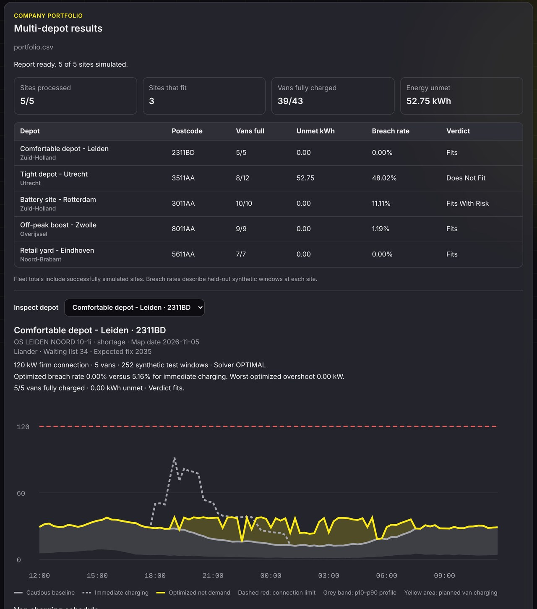

<p align="center">
  
</p>

# GridFlex AI

**Plan fleet charging around an existing electricity connection.**

GridFlex helps depot operators explore whether electric vans can receive their required energy without exceeding a site's modelled grid limit. It creates a charging schedule, replays it against held-out demand profiles, and explains the results for one depot or a portfolio.

> GridFlex is a planning prototype. Its results are simulations, not a grid-operator approval, a guarantee of capacity, or an instruction to operate equipment.

## What it does

- **Explore local capacity.** Look up an indicative Dutch grid-capacity map by postcode.
- **Build a charging plan.** Google OR-Tools CP-SAT schedules vans and an optional battery in 15-minute intervals.
- **Test the plan.** Replay the fixed schedule against held-out building-demand windows and compare it with charging immediately on arrival.
- **Assess a portfolio.** Upload a CSV containing multiple depots, inspect progress and results, and download a PDF report.
- **Understand the result.** Ask about calculated evidence using Groq or a local Qwen model, with deterministic responses for supported questions.

<p align="center">
  
</p>

## How it works

1. Provide a site's connection limit, fleet charging requirements, and optional battery. Building load can come from uploaded meter readings, an estimate based on a monthly bill, or a synthetic GLASS profile.
2. Split the building-load windows into planning and held-out test data. Meter data is split by date; synthetic profiles are split by customer sample.
3. Optimise against a cautious building-load baseline. The solver prioritises minimising unavoidable baseline overshoot, unmet fleet energy, peak demand and battery throughput.
4. Replay the fixed plan on the held-out windows. The app reports charging shortfalls, the frequency and size of limit breaches, and a verdict based on the configured tolerance.
5. Review the evidence and optionally compare a what-if scenario. AI explanations use computed facts, but numerical checks do not guarantee that every interpretation is correct.

The detailed model, assumptions and interfaces are documented in [idea.md](idea.md).

## Quick start

### Requirements

- Python 3.11 and Node.js LTS
- Git and an internet connection
- Prepared data: approximately 215 MB, or about 15 GB free if downloading and processing all raw datasets

### 1. Clone and install

```bash
git clone https://github.com/Second-Opinion-Dev/gridflex_ai.git
cd gridflex_ai
python3 -m venv .venv
source .venv/bin/activate
python -m pip install -r requirements.txt
```

On Windows PowerShell, activate the environment with `.venv\Scripts\Activate.ps1` instead.

### 2. Prepare the data

Processed data is not committed to Git. If you have a verified ZIP created with `setup_data.py pack`, run:

```bash
python scripts/setup_data.py unpack path/to/processed_data.zip
python scripts/setup_data.py status
```

Alternatively, download and build the data yourself:

```bash
python scripts/download_data.py
python scripts/setup_data.py build
python scripts/setup_data.py status
```

The raw downloads total approximately 13.6 GB. The status command reports whether the GLASS, grid-map and Liander extracts are present. For sources and licensing, see [data/README.md](data/README.md).

### 3. Start the API and dashboard

In the activated environment, from the repository root:

```bash
python -m uvicorn api.main:app --reload --port 8000
```

In a second terminal:

```bash
cd ui
npm ci
npm run dev
```

Open the URL printed by Vite. The dashboard defaults to an API at `http://127.0.0.1:8000`; set `VITE_GRIDFLEX_API_URL` when the API runs elsewhere. See [ui/README.md](ui/README.md) for frontend and local-model details.

### 4. Try an example

The [examples](examples/README.md) include individual depots, meter-data uploads, a five-depot portfolio, a 30-depot portfolio and a 649-depot stress test. The examples are demonstrations, not operational recommendations.

### Optional: model-generated explanations

For Groq, add `GROQ_API_KEY` to a Git-ignored `.env` file in the repository root and restart the API. Never commit credentials. You can also use a locally running Ollama model; the portfolio assistant defaults to `qwen3:4b-instruct`, while the single-depot explanation defaults to `qwen3.5:9b`. See [ui/README.md](ui/README.md) for the model override.

When Groq is selected, questions and relevant computed context are sent to the provider. Meter uploads are held in API memory until restart; portfolio results are stored locally in `.gridflex-local/` until deleted. This prototype has no user authentication or automatic retention policy.

## Tests

```bash
python -m pytest
```

```bash
cd ui
npm test
```

Tests that need processed data skip when the relevant files are unavailable.

## Project structure

```text
api/        FastAPI endpoints, CSV parsing and local result storage
gridflex/   Load profiles, scheduling, replay, risk and explanations
ui/         React and TypeScript dashboard
scripts/    Data download, preparation and packaging
examples/   Example depot, portfolio and meter-data inputs
tests/      Backend tests
docs/       Dashboard images
data/       Dataset documentation; local data is Git-ignored
video/      Remotion pitch-video project
idea.md     Detailed design, assumptions and interfaces
AGENTS.md   Repository and contributor instructions
```

## Data and limitations

- **GLASS:** synthetic electricity profiles from TU Delft / OpenSynth, distributed under CDLA-Permissive-2.0. [Dataset](https://doi.org/10.4121/b18de4df-0f67-4a6f-aa84-6634cdd63991).
- **Grid-capacity map:** indicative postcode-level snapshot from [Netbeheer Nederland](https://capaciteitskaart.netbeheernederland.nl); check its displayed date and confirm capacity with the grid operator.
- **Liander profiles:** 2023 reference profiles from [Liander open data](https://www.liander.nl/over-ons/open-data). The GLASS comparison is not independent validation because GLASS was trained on Liander data.
- **Replay:** risk describes the selected held-out windows under a fixed simulated timetable. It is not a probability guarantee for a real site. Battery replay has the clipping limitation described in [idea.md](idea.md).

## Contributing

Create a descriptive branch and open a pull request to `main` with the problem, changes and validation. Follow [AGENTS.md](AGENTS.md) and avoid committing credentials, uploaded customer data, raw datasets or generated build output.

Built for the EY AI Week Hackathon in Amsterdam. Original concept by Smriti Sridhar; developed by the GridFlex team.
